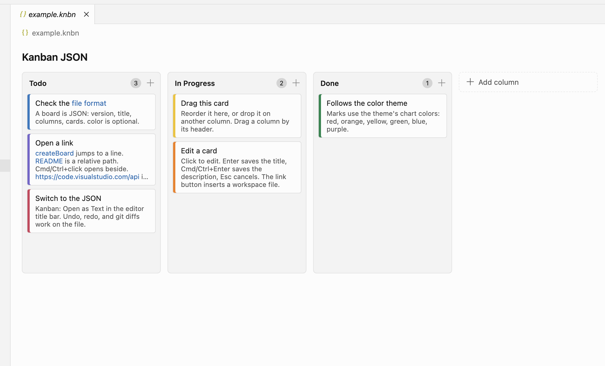

# Kanban JSON

Minimal kanban editor for `.knbn` files. The board follows your color theme, and the JSON file stays the source of truth: undo, redo, git diffs, and external edits work like any text file.



## Features

- Columns: add, rename (double-click the title), delete, reorder by dragging the header.
- Cards: add, edit title and description (click), delete, drag within and between columns.
- Color marks (`red`, `orange`, `yellow`, `green`, `blue`, `purple`), drawn with the theme's chart colors.
- Edits, including undo and redo, are saved immediately.
- Markdown links and bare URLs in titles and descriptions. Paths resolve relative to the board file, then the workspace. Click opens the file; `Cmd/Ctrl+click` opens it beside the board. The link button in the card editor inserts a workspace file.
- `Kanban: Open as Text` / `Kanban: Open as Board` in the editor title bar.
- JSON schema validation and completion in the text view.

Create a board with `Kanban: New Board` (command palette or a folder's context menu). An empty `*.knbn` file is initialized on open.

`Enter` saves a card title, `Cmd/Ctrl+Enter` saves the description, `Esc` cancels. `Enter` on a focused card starts editing.

## File format

```json
{
  "version": 1,
  "title": "My board",
  "columns": [
    {
      "id": "c_x1y2z3",
      "title": "Todo",
      "cards": [
        { "id": "k_a1b2c3", "title": "Write spec", "description": "optional", "color": "blue" }
      ]
    }
  ]
}
```

IDs must be unique. Order is array order. `color` and `description` are optional. Unknown fields are preserved.
